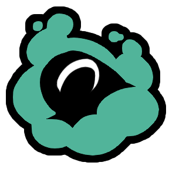

  
  Chameleon
  
  ---

<table width="100%">
  <tr>
    <td align="left"><b>Alignment: </b>Crewmate</td>
    <td align="right"><b>Sub-alignment: </b>Crewmate Investigative</td>
  </tr>
</table>

<b>Wiki Description: </b>The Chameleon is a Crewmate Investigative role that can use their ability to temporarily turn invisible to all other players. During the time that they are invisible, the Chameleon will get a speed boost, and if settings allow, the ability to vent. Idea by mystic_haze2

<b>Options: </b>

- Max Camouflage Uses
- Camouflage Cooldown
- Camouflage Duration
- Camouflage Speed Boost
- Can Vent While Camouflaged